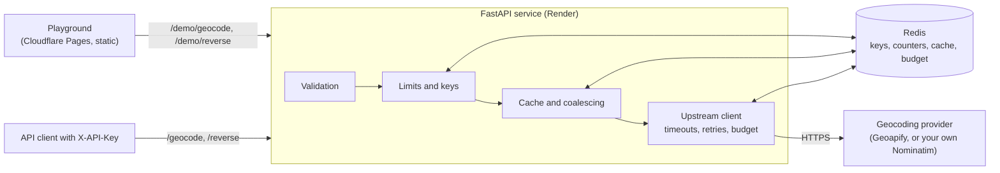

# Geocoding API

An address-search and reverse-geocoding API built with Python and FastAPI, with a browser playground for trying requests and inspecting GeoJSON responses.

The service calls a configured geocoding provider and adds input validation, shared caching, API-key access, usage limits, and consistent responses.

The hosted playground is not deployed yet. [docs/OPERATIONS.md](docs/OPERATIONS.md#deployment) lists the setup steps.

## Architecture



Everything that must be consistent between processes (API keys and
revocation, usage counters, rate limits, cached responses and the provider
budget) lives in Redis. The API processes keep no state of their own, so any
number of workers or replicas behave as one. This project does not contain
map data or a geocoding engine; results come from the configured provider.

For a step-by-step walk through one search, read [docs/LEARNING.md](docs/LEARNING.md).

## Endpoints

| Method and path | Auth | Purpose |
|---|---|---|
| `GET /geocode` | `X-API-Key` | Search for an address or place |
| `GET /reverse` | `X-API-Key` | Nearest address to a coordinate |
| `GET /demo/geocode`, `GET /demo/reverse` | none, small per-visitor and daily limits | Used by the playground |
| `GET /usage` | `X-API-Key` | Today's and the last seven days' usage for your key |
| `POST /admin/keys`, `GET /admin/keys`, `DELETE /admin/keys/{id}` | `X-Admin-Secret` | Create, list and revoke keys |
| `GET /metrics` | `X-Admin-Secret` | Prometheus metrics |
| `GET /health/live`, `GET /health/ready` | none | Process health; Redis readiness |
| `GET /autocomplete` | n/a | Disabled, returns 501 |
| `GET /docs` | none | Interactive OpenAPI documentation |

Search parameters: `q` (required, up to 200 characters), `limit` (1 to 10,
default 5; at most 5 on the demo), `countrycodes` (comma-separated ISO 3166-1
alpha-2 codes), `viewbox` (`min_lon,min_lat,max_lon,max_lat`, results must lie
inside), `lang` (ISO 639-1). Reverse parameters: `lat`, `lon`, `lang`.
Unknown or repeated parameters are rejected rather than ignored.

### Example

Search with an API key:

```bash
curl -s "http://localhost:8000/geocode?q=Durbar+Square,+Kathmandu&limit=1" \
  -H "X-API-Key: $API_KEY"
```

The response below came from the local fake provider (`tools/fake_upstream.py`),
so the address and coordinates are made up; the shape is the same with Geoapify.

```json
{
  "type": "FeatureCollection",
  "query": {"q": "Durbar Square, Kathmandu", "limit": 1, "countrycodes": [], "viewbox": null, "lang": null},
  "features": [
    {
      "type": "Feature",
      "id": "geoapify:fakecc499d7ca667",
      "geometry": {"type": "Point", "coordinates": [-34.54, -1.37]},
      "properties": {
        "label": "Durbar Square, Kathmandu, 100 Main Street, Exampleville",
        "name": "Durbar Square, Kathmandu",
        "kind": "building",
        "address": {"housenumber": "100", "street": "Main Street", "city": "Exampleville",
                    "state": "Example State", "postcode": "00000", "country": "Exampleland", "country_code": "xx"},
        "provider": "geoapify",
        "provider_place_id": "fakecc499d7ca667",
        "confidence": 0.9
      }
    }
  ],
  "attribution": [
    {"text": "Powered by Geoapify", "url": "https://www.geoapify.com/"},
    {"text": "© OpenStreetMap contributors", "url": "https://www.openstreetmap.org/copyright"}
  ]
}
```

Headers on that response included `X-Cache: MISS`, `X-RateLimit-Limit: 60`,
`X-RateLimit-Remaining: 59` and an `X-Request-ID`. Reverse lookup works the
same way: `GET /reverse?lat=27.7044&lon=85.3073`.

Responses are GeoJSON `FeatureCollection`s. Coordinates are in GeoJSON order,
longitude then latitude. `confidence` appears only when the provider supplies
one (Geoapify's `rank.confidence`); this service does not invent scores.
`attribution` lists the credits the provider requires.

## Authentication and administration

* API keys are sent in the `X-API-Key` header. Keys in the URL are rejected.
* Keys are random (`gk_<id>_<secret>`), stored only as SHA-256 hashes, shown
  once when created, and can be revoked by id; revocation takes effect on the
  next request in every worker.
* Administration uses a separate `X-Admin-Secret` header, compared in
  constant time. API keys cannot reach admin routes, and the admin secret
  cannot be used as an API key.
* With `APP_ENV=production` the service refuses to start without a strong
  admin secret, a non-local Redis URL and a configured provider.

```bash
curl -X POST http://localhost:8000/admin/keys \
  -H "X-Admin-Secret: $ADMIN_SECRET" -H "Content-Type: application/json" \
  -d '{"name": "my app", "rate_per_minute": 30, "daily_limit": 500}'
```

## Rate limits, quotas and failures

See [docs/OPERATIONS.md](docs/OPERATIONS.md) for every limit, the response
headers, the error codes and how failures behave. In short: each key and each
playground visitor has per-minute and per-day limits, the playground has a
shared daily total, and every caller shares a daily and per-second provider
budget that keeps usage inside the provider's free plan. If Redis is
unavailable the API returns 503 rather than running without limits.

## Provider configuration and attribution

`PROVIDER` has no default; the service will not start until you choose one.

* **Geoapify** (`PROVIDER=geoapify`, `GEOAPIFY_API_KEY=...`): used by the
  hosted playground on the Free plan. Its terms require "Powered by Geoapify"
  and OpenStreetMap attribution, which every response includes and the
  playground displays. Geoapify's licence is not sublicensable, so the hosted
  service offers the limited playground only; other developers should run
  their own copy with their own provider account.
* **Nominatim** (`PROVIDER=nominatim`, `NOMINATIM_BASE_URL`,
  `NOMINATIM_USER_AGENT`): for an instance you run yourself or are otherwise
  permitted to use. The public `nominatim.openstreetmap.org` is refused: its
  usage policy forbids autocomplete and using it as the backend of a service
  like this.

| This API | Geoapify | Nominatim |
|---|---|---|
| `q` | `text` | `q` |
| `limit` | `limit` | `limit` |
| `countrycodes` | `filter=countrycode:..` | `countrycodes` |
| `viewbox` (results must be inside) | `filter=rect:..` | `viewbox` + `bounded=1` |
| `lang` | `lang` | `accept-language` |

Searches are sent to the configured provider. The API caches results in
Redis (one day; one hour for empty results). Its own logs record the route,
status and timing of each request but not the search text.

## Local setup

Requirements: Python 3.13, Node 22, Redis 7.

```bash
git clone https://github.com/Niyog59/Geocoding-API.git && cd Geocoding-API
make setup                 # Python venv + frontend packages
cp .env.example .env       # then set ADMIN_SECRET; see below for the provider
make redis                 # terminal 1: Redis with an append-only file
make fake                  # terminal 2: fake provider (no key or credits needed)
make api                   # terminal 3: API on http://localhost:8000/docs
make frontend              # terminal 4: playground on http://localhost:5173
```

To use the fake provider, set `PROVIDER=geoapify`,
`GEOAPIFY_API_KEY=local-fake` and `GEOAPIFY_BASE_URL=http://localhost:9100`
in `.env`. With Docker: `docker compose --profile fake up`.

## Testing

```bash
make test           # unit + Redis integration tests (starts its own Redis servers)
make test-browser   # Playwright, with Redis running on :6379
make lint           # ruff, mypy --strict, TypeScript
```

What the tests cover:

* `tests/test_regressions.py`: one or more tests for each of the 15 review
  findings in [docs/FINDINGS.md](docs/FINDINGS.md).
* Unit and API tests for keys, limits, cache, validation, providers,
  retries and timeouts, run against a real Redis server.
* `tests/test_redis_cost.py`: fails if a request starts using more Redis
  commands than [docs/OPERATIONS.md](docs/OPERATIONS.md#redis-usage) documents.
* `tests/integration`: real uvicorn processes with two workers sharing one
  Redis, restarts, Redis persistence and a Redis outage.
* `frontend/tests`: Playwright tests of the playground against a mocked API
  and against the real API with the fake provider, including axe
  accessibility checks.

CI (`.github/workflows/ci.yml`) runs linting and type checks, all of the above,
the frontend build, a Docker build and startup check, `pip-audit`,
`npm audit` and a gitleaks secret scan.

No automated test calls a real provider; they use `tools/fake_upstream.py`.

## Benchmarks

`make bench` runs a reproducible local benchmark against the fake provider
(fixed 100 ms delay), 5 minutes at 10 requests per second for each workload.
Final run on a 2-CPU cloud container, one worker, Redis on the same machine:

| Workload | p50 | p95 | p99 | Errors |
|---|---|---|---|---|
| Cache hit | 4.6 ms | 6.3 ms | 8.6 ms | 0 of 3000 |
| Cache miss (includes the 100 ms provider delay) | 108.2 ms | 111.6 ms | 114.4 ms | 0 of 3000 |

Limits held under concurrent load (exactly 30 of 200 simultaneous requests
allowed on a 30-per-minute key, every revoked-key request refused) and the
provider budget was never exceeded. These are local numbers; the hosted
version adds network time to Redis and runs on a small shared CPU. Details,
environment and Lighthouse results: [docs/BENCHMARKS.md](docs/BENCHMARKS.md).

## Deployment

See [docs/OPERATIONS.md](docs/OPERATIONS.md#deployment) for the
step-by-step setup on Cloudflare Pages, Render, Upstash and Geoapify.

## Breaking changes from version 2

* API keys are only accepted in `X-API-Key`; `?api_key=` returns 400. The
  built-in demo key is gone.
* `POST /keys/generate?master_key=...` is replaced by `POST /admin/keys` with
  the `X-Admin-Secret` header.
* `/autocomplete` is disabled (501).
* Responses are GeoJSON features with a `properties` object. The
  Mapbox-style `text`, `place_name`, `center`, `context`, `place_type`,
  `relevance` and `query` array fields were removed.
* A reverse lookup with no address returns 200 with no features instead of
  404. `zoom` is no longer accepted.
* `GET /` no longer reports key or cache counts; use `/health/live` and
  `/health/ready`.
* `NOMINATIM_BASE_URL` no longer defaults to the public server, and
  `PROVIDER` must be set.

## Known limitations

* The hosted playground has small daily limits and a shared daily total, and
  its backend sleeps when idle (see [docs/OPERATIONS.md](docs/OPERATIONS.md)).
* Results are only as good as the configured provider; this project adds no
  geocoding of its own.
* Rate limits use fixed windows, so a caller can make up to twice the
  per-minute limit across a minute boundary.
* Per-visitor demo limits on Render depend on how Render sets
  `X-Forwarded-For`, which is not verified yet; shared totals still apply.
* The provider budget counts this service's calls only, not other use of the
  same provider account.
* Autocomplete is disabled.
* The hosted service is for the playground only, because the Geoapify licence
  is not sublicensable.

## Review findings

[docs/FINDINGS.md](docs/FINDINGS.md) maps each finding to its fix, tests and
commit.

## License

MIT

Data © OpenStreetMap contributors. Hosted playground powered by Geoapify.
