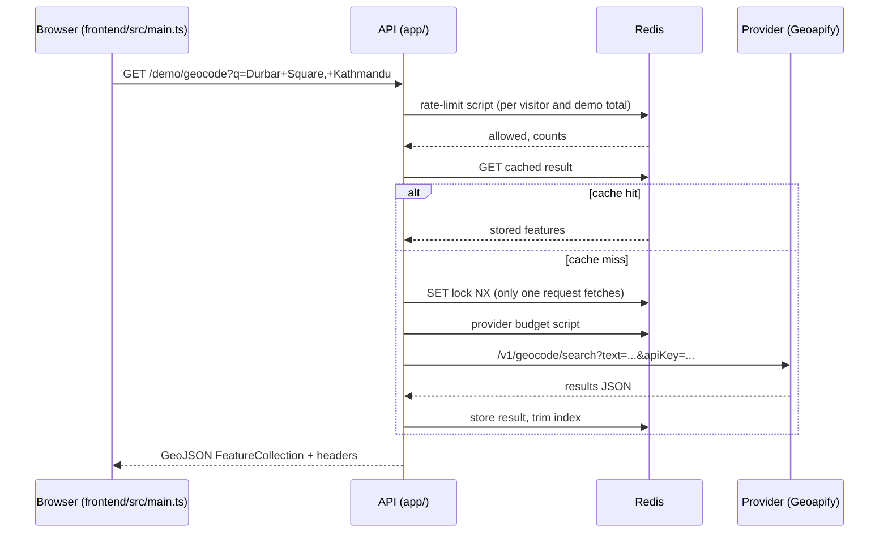

# How a search travels through this project

This guide follows one search, "Durbar Square, Kathmandu", from the
playground to the geocoding provider and back. Each step names the file that
does the work, so you can read along.

## 1. The browser sends the request

`frontend/src/main.ts`, function `run`.

When you press **Search**, the page builds a URL such as
`/demo/geocode?q=Durbar+Square,+Kathmandu&limit=5` and calls `fetch`. It
starts a timer so it can show "Request time", and it keeps an
`AbortController`. If you search again before the answer arrives, the old
request is cancelled and a sequence number makes sure a late answer can never
replace a newer one.

The page never holds a secret. It calls the `/demo` routes, which need no key
because their limits are enforced on the server.

## 2. The API gives the request an ID

`app/main.py`, middleware `request_context`.

Every request gets an ID like `req_3f2a...`. It is stored in a context
variable, so every log line written while handling this request carries the
same ID, even lines written by libraries. The ID is returned in the
`X-Request-ID` header and inside every error body, which lets you match a
user's error message to the server's logs.

The middleware also refuses any URL that carries something that looks like a
credential (`?api_key=...`), because URLs end up in browser history and logs.

## 3. Limits are checked in Redis

`app/routes/deps.py` (`demo_access`) and `app/limits.py` (`RateLimiter`).

**What Redis is:** a separate server that keeps data in memory and answers
very small commands very quickly. Every copy of the API talks to the same
Redis, so they share one view of keys, counters and cached results.

**What a worker is:** one Python process running the API. A server can run
several workers so it can use more than one CPU core. Each worker has its own
memory. That is exactly why counters must not live in Python variables: with
two workers, each would allow the full limit and the real limit would double.
The original code had this problem.

**Rate limit:** the demo allows each visitor 10 searches per minute and 50 per
day (as deployed), and all visitors together 500 per day. Each limit is a
counter in Redis whose name includes the time window, for example
`geo:rl:demo:203.0.113.7:m:29467731` for one minute. A small Lua script runs
inside Redis and, in one step, adds one to every counter and checks them. If
any counter is now over its limit, the script takes the increments back and
the API answers `429 rate_limited` (or `503 quota_exhausted` for the shared
daily total) with a `Retry-After` header. Because Redis runs the script as a
single step, two requests arriving at the same moment cannot both squeeze
through.

**API keys** (for the keyed `/geocode` route, not the demo) work the same way,
with limits stored per key. Keys are random strings like `gk_<id>_<secret>`.
Redis stores only a SHA-256 hash of each key (`app/auth.py`), so even someone
who copies the database cannot use the keys. The key is shown once, when the
administrator creates it, and can be revoked by its id.

## 4. The input is checked and normalised

`app/validation.py`, function `search_params`.

The query is trimmed, repeated spaces are collapsed, and it must be 1 to 200
characters. Country codes must be two letters; they are lower-cased, sorted
and de-duplicated, so `FR, de` and `de,fr` mean the same thing. Unknown
parameters are rejected with a message rather than silently ignored.

## 5. The cache is checked

`app/service.py` and `app/cache.py`.

**What a cache hit is:** the API has answered this exact question recently and
kept the answer in Redis. A hit returns the stored answer without calling the
provider: it is faster and costs no provider credits. A miss means the API has
to ask the provider.

The cache key is a SHA-256 hash of everything that could change the answer:
the operation, provider, normalised query, limit, countries, viewbox and
language. The original code left `viewbox` out, so a search limited to one
area could return results cached for another area. Matching is
case-insensitive, because providers treat "berlin" and "Berlin" the same.

If ten people search for the same new place at the same moment, only one
request calls the provider. Inside one worker the others wait for the same
task; across workers the first request sets a short lock in Redis
(`SET ... NX`) and the others wait for the stored result. The response header
`X-Cache` says `HIT`, `MISS` or `SHARED`.

## 6. The provider is called, within the budget

`app/upstream.py` and `app/providers/geoapify.py`.

**What the upstream provider is:** this project does not contain map data or
a geocoding engine. It forwards the question to a provider (Geoapify on the
hosted version), which looks it up in OpenStreetMap-based data. This project
adds validation, caching, keys, limits and consistent responses around that
call.

Before each call, including each retry, the API takes one unit from the
provider budget in Redis: at most 4 calls per second and 1000 per day for the
hosted version, shared by every worker. This keeps the project inside
Geoapify's free plan (3000 credits per day, 5 requests per second) with room
to spare.

The call uses one shared HTTP client with timeouts. At most a few calls run at
once, a request never takes longer than its deadline (8 seconds by default),
and only failures that a retry can fix (timeouts, 502/503/504, 429) are
retried, once. If the provider says how long to wait (`Retry-After`) and it is
short, the API waits; if it is long, the API passes it back to you instead.

## 7. The answer is converted to GeoJSON and stored

`app/places.py`.

The provider's results become `Place` objects and then GeoJSON features.
GeoJSON puts longitude before latitude: `[85.3073, 27.7044]`. Each feature
gets a stable ID: the provider's own ID, or a SHA-256 of its contents (never
Python's `hash()`, which changes every time a process starts). The label falls
back from the provider's formatted address to address parts, and finally to
the coordinates. Scores appear only when the provider supplies them.

The result is stored in Redis for a day (an hour if it was empty), and the
oldest entries are removed once there are more than the configured maximum.

## 8. The browser shows the result

Back in `frontend/src/main.ts`, `showResults` builds the list with
`textContent`, never `innerHTML`, so text from the provider cannot run as
code. The page shows the HTTP status, "Request time" (measured in the browser,
so it includes network time) and the cache outcome, plus the attribution the
provider requires.

## Where to look when something goes wrong

| Symptom | Where to look |
|---|---|
| 401 errors | `app/routes/deps.py` (`authenticate`) and `app/auth.py` |
| 429 or quota errors | `app/limits.py` |
| Wrong or stale results | `app/cache.py`, `app/service.py` (the cache identity) |
| 502/503/504 errors | `app/upstream.py` and the logs for that request ID |
| The app will not start | `app/config.py` explains every rejected setting |
